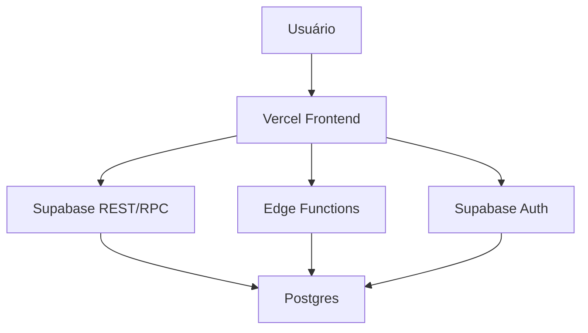
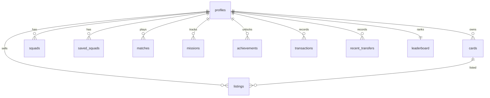
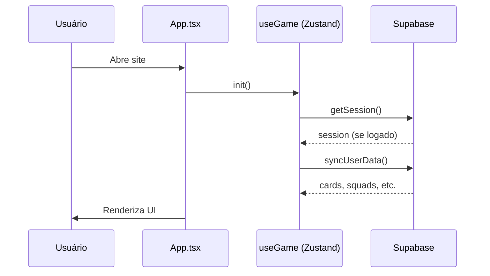
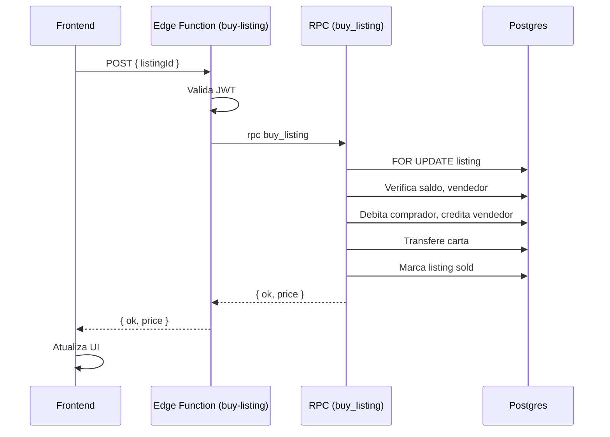

# AUDITORIA TÉCNICA DO BACKEND — FUTSENAI CARDS

## 1. Resumo executivo

O FutSENAI Cards é um jogo de cartas de futsal com backend real (Supabase/Postgres), autenticação (email/senha + Google OAuth), persistência parcial de dados do jogo, marketplace com compras atômicas (Edge Function + RPC) e frontend em React/Vite hospedado na Vercel.

**Estado geral:** A arquitetura é funcional, com RLS e policies configuradas. A migração de dados do jogo para o Supabase está avançada (cartas, squads, partidas, missões, conquistas, SBC, transações, settings, favoritos, compare history, packsOpened, lastDailyClaim, XP/nível, eventos, newCardUids, packConfigs, savedSquads, listings, coins). Pendências: camada de auth centralizada, testes de integração, monitoramento, limitar tentativas de login.

---

## 2. Arquitetura atual

- **Frontend:** React 19 + TypeScript + Vite 8 + Tailwind CSS 4 + Framer Motion.
- **Estado:** Zustand (persistido em `localStorage` como `futsenai-cards-v3`).
- **Roteamento:** React Router (BrowserRouter) com rotas protegidas (`ProtectedRoute`).
- **Backend:** Supabase (Postgres, Auth, RLS, Edge Functions, Realtime).
- **Deploy:** Vercel (frontend estático, SPA fallback via `vercel.json`).
- **Áudio:** Web Audio API (osciladores) + arquivo MP3 (lofi).

**Comunicação:** Frontend → Supabase JS Client → Supabase API (REST/RPC/Edge Functions) → Postgres.



**Client-side:** UI, estado local, validações de interface, animações, áudio.
**Server-side:** Auth, RLS, RPCs, Edge Functions, persistência.

---

## 3. Stack tecnológica

| Tecnologia | Versão | Uso |
|---|---|---|
| React | 19.3.1 | UI |
| TypeScript | ~6.0.3 | Tipagem |
| Vite | 8.3.4 | Build/dev |
| Tailwind CSS | 4.3.3 | Estilos |
| Framer Motion | 14.6.0 | Animações |
| Zustand | 5.0.16 | Estado global + persist |
| React Router | 7.18.4 | Rotas |
| Supabase JS | 2.118.0 | Auth, DB, Edge Functions |
| lucide-react | 1.61.0 | Ícones SVG |
| nanoid | 6.0.2 | IDs |
| Jest | 30.5.2 | Testes |
| oxlint | 1.88.0 | Lint |

Scripts: `dev` (vite), `build` (tsc -b && vite build), `test` (jest), `lint` (oxlint), `preview` (vite preview).

---

## 4. Estrutura de arquivos

```
src/
  App.tsx              # Rotas, layout, loading, tutorial, toasts
  main.tsx             # Entry point
  types.ts             # Tipos e interfaces
  components/          # Card, Layout, ToastContainer, Tutorial, LoadingScreen, ConfirmModal, Skeleton, Tooltip, ProtectedRoute
  data/players.ts      # Templates de jogadores (futsal)
  engine/match.ts      # Simulação de partidas
  lib/game.ts          # Packs, missões, conquistas, formações, raridade, XP
  lib/sound.ts         # Efeitos sonoros
  lib/supabase.ts      # Cliente Supabase
  lib/profile.ts       # Serviço de perfil
  lib/services/        # auth, cards, squads, matches, marketplace, missions, achievements, sbc, transactions, settings, leaderboard
  pages/               # Home, Packs, OpenPack, Collection, CardDetail, Squad, Match, Compare, Marketplace, SBC, Missions, Shop, Profile, Settings, NotFound, Auth
  store/useGame.ts     # Estado global (Zustand)
  store/toast.ts       # Toasts
  types/images.d.ts    # Declarações de módulos de imagem
supabase/
  functions/delete-account/index.ts
  functions/buy-listing/index.ts
public/                # favicon, robots.txt, sitemap.xml, llms.txt, etc.
```

---

## 5. Ciclo de vida da aplicação

1. Navegador carrega `index.html` + bundle Vite.
2. `main.tsx` monta `<App />`.
3. `App.tsx` exibe `LoadingScreen` até `init()` (exceto 404).
4. `useGame.getState().init()` roda: migra packs, seed events, updateMissionProgress, sync com Supabase se logado.
5. `ProtectedRoute` verifica sessão; sem sessão redireciona para `/auth`.
6. Rotas renderizam dentro de `Layout`.
7. Navegação via React Router.
8. Dados salvos/atualizados via store + sync Supabase.
9. Logout: `signOut()` + limpa `localStorage` + redirect `/auth`.

Tratamento de erros: try/catch, toasts, mensagens na UI. Carregamento: `LoadingScreen`.

---

## 6. Autenticação e contas

**Fluxos:**
- Cadastro: `signUp(name, email, password)` → Supabase Auth → trigger `handle_new_user` cria `profiles`.
- Login: `signIn(email, password)` ou `signInWithGoogle()` (OAuth).
- Recuperação: `resetPassword(email)` → email → link com `type=recovery` → `updatePassword(newPassword)`.
- Alteração: `updateEmail`, `updatePassword` (Profile).
- Exclusão: Edge Function `delete-account` valida JWT, deleta dados e usuário.
- Sessão: restaurada via `supabase.auth.getSession()`; renovação automática.
- Proteção: `ProtectedRoute` bloqueia rotas privadas sem sessão.

**Centralização:** `src/lib/services/auth.ts` concentra todas as funções.

**Segredos:** apenas publishable key no frontend; service_role apenas nas Edge Functions.

---

## 7. Banco de dados

Tabelas principais (schema real):

| Tabela | Finalidade | Colunas chave |
|---|---|---|
| `profiles` | Conta do usuário | id (PK, FK auth.users), name, avatar_url, coins, xp, level, preferences (jsonb), packs_opened, last_daily_claim, created_at |
| `cards` | Inventário de cartas | id (PK), user_id (FK), player_id, name, position, sport, rarity, edition, special, overall, pace, shooting, passing, dribbling, defending, physical, reflexes, positioning, handling, xp, evo_points, upgrades, evolution_log, season_stats, image, favorite, is_new, obtained_at |
| `squads` | Elenco ativo | id, user_id, formation, starters (jsonb), bench (jsonb), is_primary |
| `saved_squads` | Elencos salvos | id, user_id, name, formation, starters, bench, is_primary, created_at |
| `matches` | Histórico de partidas | id, user_id, sport, home_score, away_score, opponent, played_at |
| `missions` | Missões por usuário | id, user_id, mission_id, title, description, target, progress, reward, reward_xp, type, completed, claimed |
| `achievements` | Conquistas | id, user_id, achievement_id, title, description, unlocked, unlocked_at |
| `listings` | Anúncios do mercado | id, seller_id, card_id, card_name, card_overall, card_position, card_rarity, card_image, card_attributes (jsonb), price, buy_now, expires_at, status |
| `transactions` | Histórico financeiro | id, user_id, amount, reason, type, created_at |
| `price_history` | Histórico de preços | id, card_name, price, created_at |
| `recent_transfers` | Transferências recentes | id, user_id, card_name, price, type, created_at |
| `leaderboard` | Ranking | user_id (PK), name, wins, points, cards_count, squad_overall, rare_count, updated_at |
| `sbc_completions` | SBCs concluídos | id, user_id, sbc_id, completed_at |

**Diagrama ER:**


---

## 8. RLS e permissões

- RLS habilitado em todas as tabelas.
- Policies para `authenticated` com `USING (auth.uid() = user_id)` (ou `id` em profiles).
- Listings: SELECT público para `authenticated`, ALL para dono.
- Price history: SELECT/INSERT para `authenticated`.
- Leaderboard: SELECT público, ALL para dono.
- Grants: `all` para `authenticated` em todas as tabelas; `select` para `anon` em tabelas públicas.
- `sbc_completions` policy para `public` (deveria ser `authenticated` — pendência).

---

## 9. Backend, Edge Functions e RPCs

**Edge Functions:**
1. `delete-account` (`supabase/functions/delete-account/index.ts`): valida JWT, deleta dados e usuário via service_role. CORS habilitado.
2. `buy-listing` (`supabase/functions/buy-listing/index.ts`): valida JWT, chama RPC `buy_listing`.

**RPC:**
- `buy_listing(p_listing_id, p_buyer_id)`: transação atômica — bloqueia anúncio (FOR UPDATE), valida disponibilidade, saldo, vendedor ≠ comprador, debita comprador, credita vendedor, transfere carta, marca anúncio como vendido. Reverte tudo se falhar.

**Validações no servidor:** JWT, saldo, propriedade, status do anúncio, expiração. Preço lido do banco.

---

## 10. Estado global, persistência e sincronização

- **Store:** `useGame` (Zustand) persistido em `localStorage` (`futsenai-cards-v3`).
- **Sincronização:** `syncUserData(userId)` carrega do Supabase ao login; ações sincronizam com o banco.
- **Dados locais:** toast (não persistido).
- **Risco de divergência:** mitigado por sync on login; mas ações locais podem não sincronizar em falhas de rede.

---

## 11. Funcionalidades do jogo

- **Cartas:** 11 templates futsal, atributos fixos, overall calculado com pesos por posição.
- **Pacotes:** 8 tipos, probabilidades por raridade.
- **Elencos:** formações futsal (1-2-1, 2-2, 3-1, 4-0). Auto-build, salvar/carregar.
- **Partidas:** simulação determinística, frames 2D, estatísticas.
- **Missões:** 5 tipos.
- **Conquistas:** 6 achievements.
- **SBCs:** 6 desafios.
- **Mercado:** listagens NPC + usuário, filtros, compra/lance.
- **Coleção:** filtros, ordenação, paginação, álbum, conversão de duplicatas, favoritos.
- **Configurações:** áudio, animações, alto contraste.
- **Evolução:** XP, evoPoints, upgrades.

---

## 12. Marketplace e economia

- Anunciar: `listCard` cria listing local + sync Supabase.
- Comprar: `buyListing` → Edge Function → RPC (atômico).
- Cancelar: `cancelListing` → atualiza status.
- Listagens NPC: desabilitadas.
- Preço validado no servidor.
- Saldo nunca negativo.
- Carta não pode ser comprada duas vezes.
- Comprador não pode comprar próprio anúncio.

---

## 13. Logs, erros e observabilidade

- Uso de `console.log/warn/error` em vários arquivos.
- Sem logger centralizado.
- Sem monitoramento externo.
- Erros exibidos via toasts e mensagens na UI.
- Sem captura de erros globais.
- Risco: logs podem conter dados sensíveis.

---

## 14. Segurança geral

| Risco | Classificação | Evidência |
|---|---|---|
| service_role não exposta | ✅ OK | Apenas publishable key no frontend |
| RLS ativo | ✅ OK | Todas as tabelas |
| Compras atômicas | ✅ OK | RPC + Edge Function |
| Preço validado no servidor | ✅ OK | RPC lê do banco |
| Limitar tentativas de login | ❌ Ausente | Sem rate limiting |
| Testes de segurança | ❌ Ausente | Sem testes de integração |
| Logs de eventos | ❌ Ausente | Sem auditoria |
| Monitoramento | ❌ Ausente | Sem alertas |
| CORS Edge Functions | ✅ OK | Headers configurados |
| Redirects OAuth | ✅ OK | URLs configuradas |

---

## 15. Frontend, rotas e interface

Rotas (BrowserRouter): `/`, `/packs`, `/open/:packId`, `/collection`, `/card/:uid`, `/squad`, `/match`, `/compare`, `/market`, `/sbc`, `/missions`, `/shop`, `/profile`, `/settings`, `/auth`, `*`.

Layout: sidebar (desktop), drawer (mobile), bottom nav (mobile). ProtectedRoute envolve Layout. Auth fora do Layout.

---

## 16. Build, ambientes e deploy

- **Dev:** `npm run dev` (Vite)
- **Build:** `npm run build` (`tsc -b && vite build`)
- **Test:** `npm test` (Jest)
- **Lint:** `npm run lint` (oxlint)
- **Preview:** `npm run preview`
- **Env vars:** `VITE_SUPABASE_URL`, `VITE_SUPABASE_ANON_KEY`
- **Vercel:** SPA fallback via `vercel.json`, deploy automático do `main`
- **Supabase:** Edge Functions deployadas via CLI
- **Migrations:** SQL executado manualmente no Supabase SQL Editor

---

## 17. Testes e validação

Testes existentes (Jest):
- `src/lib/__tests__/utils.test.ts`: `levelFromXp`, `rollRarity` (2 testes)
- `src/lib/services/__tests__/profile.test.ts`: `getProfile`, `updateProfile` sem Supabase (2 testes)
- `src/pages/__tests__/Auth.test.tsx`: render login, toggle register, submit, forgot password (4 testes)

Total: 9 testes. Sem testes de integração ou E2E. Sem CI/CD de testes.

---

## 18. Diagramas de arquitetura e fluxos

**Inicialização:**


**Compra no marketplace:**


---

## 19. Problemas, dívida técnica e pendências

| # | Problema | Evidência | Impacto | Prioridade |
|---|---|---|---|---|
| 1 | Camada de auth não centralizada | `Auth.tsx` e `Profile.tsx` chamam Supabase diretamente | Médio | Médio |
| 2 | Marketplace: compras atômicas implementadas mas não testadas | `buy-listing` Edge Function + RPC | Alto | Alto |
| 3 | Limitar tentativas de login | Sem rate limiting configurado | Médio | Médio |
| 4 | Testes insuficientes | 9 testes, sem integração/E2E | Alto | Alto |
| 5 | Logs podem vazar dados sensíveis | `console.log` em vários arquivos | Médio | Médio |
| 6 | Sem monitoramento | Sem Sentry, alertas | Baixo | Baixo |
| 7 | `sbc_completions` policy para `public` | Deveria ser `authenticated` | Baixo | Baixo |
| 8 | Bundle grande (>500KB) | Vite warning | Baixo | Baixo |
| 9 | Assets grandes (MP3 8MB, PNGs 2MB) | Build output | Baixo | Baixo |
| 10 | Camada de auth parcialmente centralizada | `src/lib/services/auth.ts` existe mas `Auth.tsx` ainda usa Supabase diretamente em alguns pontos | Médio | Médio |

---

## 20. Glossário técnico

- **RLS:** Row Level Security.
- **JWT:** JSON Web Token.
- **Edge Function:** função serverless no Supabase (Deno).
- **RPC:** Remote Procedure Call.
- **Zustand:** gerenciador de estado React.
- **Persist:** middleware do Zustand para salvar em localStorage.
- **BrowserRouter:** roteador do React Router.
- **Vercel:** plataforma de deploy frontend.
- **Supabase:** backend-as-a-service.

---

## 21. Checklist de verificação

- [x] Autenticação (email/senha + Google)
- [x] Confirmação de email
- [x] Recuperação de senha
- [x] Alteração de email/senha
- [x] Exclusão de conta
- [x] Perfil global com trigger
- [x] Formulário de edição de perfil
- [x] RLS em todas as tabelas
- [x] GRANT de privilégios
- [x] Migração de cartas, squads, partidas, listings, missões, conquistas, SBC, transações, settings, favoritos, compareHistory, packsOpened, lastDailyClaim, XP/nível, eventos, newCardUids, packConfigs, savedSquads
- [x] Compras atômicas (Edge Function + RPC)
- [x] Testes Jest (9)
- [x] Centralização da camada de auth (parcial)
- [ ] Testes de integração/E2E
- [ ] Monitoramento e alertas
- [ ] Limitar tentativas de login

---

## 22. Conclusão

O FutSENAI Cards possui backend real (Supabase), autenticação completa, persistência de dados do jogo, marketplace com compras atômicas e interface moderna. A arquitetura é sólida, com RLS e policies adequadas. As principais pendências são: centralização completa da camada de auth, testes de integração, monitoramento e otimização de bundle/assets. O projeto está em estado funcional e pronto para evolução.
