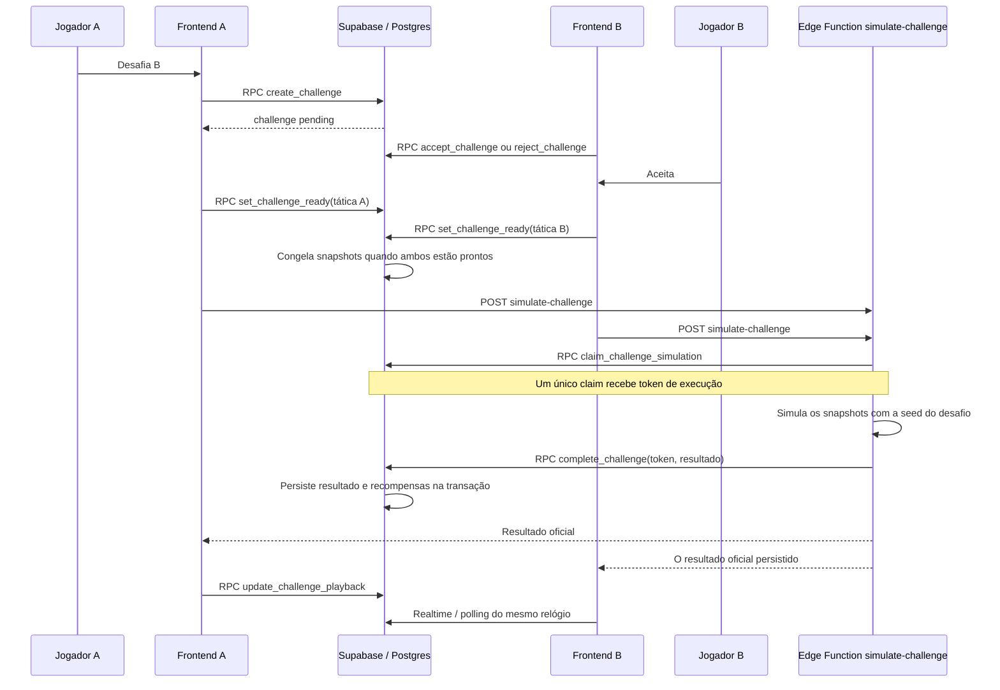

# Multiplayer PvP: funcionamento técnico

Este documento descreve exclusivamente partidas de desafio entre duas contas
(jogador A contra jogador B), conforme implementadas no frontend, no motor de
simulação e no backend Supabase do projeto.

## Visão geral

O cliente não decide o resultado PvP. Os dois clientes acompanham o desafio e
renderizam a mesma simulação, mas uma Edge Function executa a simulação
autoritativa, persiste o resultado e distribui as recompensas. O estado do
replay é compartilhado no banco.



## 1. Criação e resposta ao desafio

### A desafia B

Na tela de perfil de amigo, `FriendProfile.tsx` chama
`createChallenge(currentUserId, userId)` em
`src/lib/services/challenges.ts`. O serviço não insere diretamente na tabela:
chama `public.create_challenge(p_challenged_id uuid)`.

A função usa `auth.uid()` como desafiante; portanto, o ID do desafiante não é
confiado ao cliente. Ela:

1. rejeita usuário não autenticado, ID nulo ou tentativa de desafiar a própria
   conta;
2. verifica no banco uma amizade com `status = 'accepted'`, em qualquer
   orientação entre requester e addressee;
3. procura desafio ativo (`pending` ou `accepted`) entre o mesmo par;
4. cria a linha em `public.challenges` com estado `pending`, caso não exista
   outro desafio ativo.

Para serializar pedidos simultâneos, a função monta uma chave canônica a partir
dos UUIDs ordenados lexicalmente com `least` e `greatest`, e adquire
`pg_advisory_xact_lock(hashtextextended(chave, 0))`. Assim, A→B e B→A usam a
mesma chave de lock. A consulta e a inserção ocorrem enquanto a transação mantém
esse lock.

A migração `supabase/pvp_authority.sql` remove a política antiga de INSERT e
revoga INSERT/UPDATE direto em `challenges` para `authenticated`; criação e
transições passam pelas RPCs autorizadas.

### B aceita ou rejeita

- **Aceitar:** `acceptChallenge(id)` chama
  `public.accept_challenge(p_challenge_id uuid)`. A função só atualiza a linha
  se `auth.uid()` for `challenged_id` e o estado atual for `pending`. Define o
  estado como `accepted` e gera a seed do desafio.
- **Recusar/cancelar:** `rejectChallenge(id)` chama
  `public.reject_challenge(p_challenge_id uuid)`. Pode rejeitar um desafio
  `pending` ou cancelar um `accepted`, desde que o chamador participe, ambos
  ainda não estejam prontos e não haja token de simulação ativo. Depois que os
  dois ficam prontos, a partida não pode ser cancelada por essa RPC.

As RPCs de criação, aceitação, prontidão e rejeição são `SECURITY DEFINER`,
mas verificam `auth.uid()` na operação. `create_challenge`, `accept_challenge`,
`set_challenge_ready` e `reject_challenge` têm `EXECUTE` para `authenticated`;
não para `anon`.

## 2. Preparação: escalações, táticas e prontidão

Depois da aceitação, os dois clientes carregam a prévia por
`get-challenge-data`. A Edge Function autentica o bearer token, confirma que o
usuário participa e usa as credenciais administrativas apenas para buscar os
dados necessários. Se os dois snapshots já existem, exibe esses snapshots; se
nenhum existe e o desafio ainda não foi concluído, busca os elencos atuais para
a prévia. Um snapshot parcial ou a ausência de snapshots em desafio concluído
é erro de integridade.

### Qual escalação é usada

Na sala PvP, o usuário vê os cinco titulares, formação e overall, mas o botão
“Estou pronto” envia somente sua tática. A RPC que cria o snapshot lê o elenco
principal remoto de `public.squads`, escolhendo o registro principal mais
recentemente atualizado (`is_primary DESC, updated_at DESC`). Valida cinco
titulares distintos pertencentes ao usuário e exatamente um goleiro.

Isso é diferente do seletor de escalações existente em outras telas: a seleção
local de `selectedSquadId` não é enviada por `setReady` e não seleciona um
`saved_squads` alternativo para o snapshot PvP. Portanto, a documentação do
fluxo atual é: **o PvP usa o elenco principal salvo no servidor**, não uma
escalação alternativa escolhida no pré-jogo.

### Táticas e snapshots congelados

Cada cliente chama
`set_challenge_ready(p_challenge_id, p_tactic)` por
`setReady(id, tactic)`. A tática deve pertencer a:

`balanced | possession | highpress | counter | compact`

A RPC bloqueia a linha do desafio com `FOR UPDATE`, identifica o lado pelo
`auth.uid()`, grava sua flag `challenger_ready`/`challenged_ready` e sua tática.
Quando ambos estão prontos, constrói e grava `home_snapshot` e `away_snapshot`
na mesma transação. No caso de A desafiar B, A é o lado `home`/challenger e B é
o lado `away`/challenged.

O trigger `challenges_snapshot_immutable` rejeita UPDATEs que tentem trocar um
snapshot já preenchido. A RPC de claim também cria snapshots se ambos estiverem
prontos e ambos ainda forem nulos; se apenas um existir, aborta por
inconsistência. Depois da preparação, a Edge Function usa os snapshots e as
táticas congeladas, não recarrega os elencos atuais.

## 3. Matemática do confronto

O motor puro e determinístico fica em `src/engine/match.ts`. A Edge Function
`supabase/functions/simulate-challenge/index.ts` chama
`createPlayersFromCards` e `simulateMatch` com `mode: 'pvp'`,
`MATCH_DURATION_MINUTES` (90), os dois snapshots, as duas táticas e a seed
persistida.

### Lados, posições e validação

Cada time precisa ter exatamente cinco jogadores, com IDs únicos, jogadores
associados ao lado correto, exatamente um goleiro válido e atributos
numéricos dentro de 0–100. A função de criação de jogadores coloca o goleiro
primeiro e associa as posições iniciais da formação. As formações reconhecidas
pelo motor são `1-2-1`, `2-2`, `3-1` e `4-0`; a orientação do lado away espelha
as coordenadas.

### Relógio da simulação e aleatoriedade

- Duração atual: `90` minutos, dois tempos de `45`.
- O motor avança em ticks de `0,5` minuto, gerando um frame por tick.
- A seed inicializa `mulberry32(seed)`. As decisões aleatórias do motor
  consomem essa sequência determinística.
- Um resultado repetível exige a mesma seed, os mesmos snapshots, formação,
  tática, duração e versão/comportamento do motor.
- No fluxo PvP, os clientes não executam `simulateMatch` para determinar o
  resultado oficial. A Edge Function simula e grava um resultado; ambos recebem
  esse objeto armazenado.

### Táticas PvP realmente consumidas pelo motor

| Tática | `shoot` | `passRisk` | `press` definido | `defendLine` definido |
|---|---:|---:|---:|---:|
| Equilibrado (`balanced`) | 1,00 | 1,00 | 1,00 | 0,50 |
| Posse (`possession`) | 0,85 | 0,70 | 0,80 | 0,60 |
| Pressão alta (`highpress`) | 1,00 | 1,10 | 1,40 | 0,75 |
| Contra-ataque (`counter`) | 1,20 | 1,20 | 0,70 | 0,35 |
| Defesa compacta (`compact`) | 0,90 | 0,85 | 0,60 | 0,25 |

No código atual, a simulação consulta `shoot` e `passRisk`. Os campos `press`
e `defendLine` estão definidos, mas não são lidos pelo loop da simulação; não
há efeito matemático deles no confronto atual. Em modo PvP, o motor também não
aplica o multiplicador de dificuldade ao lado away.

### Pressão, passes e interceptações

Para o portador da bola, calcula-se a distância euclidiana aos adversários. A
pressão é `1,3` se o adversário mais próximo estiver a menos de `8` unidades;
caso contrário, é `1,0`.

A chance de o portador tentar passe em um tick é:

```text
P(passe) = 0,7 × passRisk da tática
```

O recebedor é escolhido pelo maior score:

```text
score do recebedor =
  avanço na direção do gol × 0,5
  + passing do recebedor × 0,01
  - adversários a menos de 6 unidades do recebedor × 2
  + aleatório uniforme × 5
```

O defensor usado para interceptar é o mais próximo do ponto médio entre
portador e recebedor. A chance de interceptação é:

```text
P(interceptação) = (defending do defensor / 100) × 0,15 × pressão
```

Se a interceptação falha, o passe é contabilizado como completo e a posse muda
para o recebedor.

### Condução e desarme

A chance de condução no tick em que não houve passe é:

```text
P(condução) = (dribbling do portador / 100) × 0,4 × (1 / pressão)
```

Se a condução falha, o adversário mais próximo desarma quando está a menos de
`12` unidades do portador. Esse teste de proximidade não usa um atributo de
desarme. Caso contrário, a bola fica solta. Atributos como `pace` e `physical`
fazem parte do snapshot e da validação, mas não são consultados pelas disputas
do loop atual.

### Finalização e goleiro

Um jogador pode chutar quando está no terço ofensivo (`x > 72` para home,
`x < 28` para away). A chance de tentar finalizar por tick nessa região é:

```text
P(chute) = (shooting do portador / 100)
           × shoot da tática
           × (1 / pressão)
           × 0,18
```

Depois de iniciado o chute, a chance de acertar o alvo é:

```text
P(no alvo) = (shooting / 100) × 0,7 + 0,2
```

Se o chute vai ao alvo, o goleiro adversário tenta defender com:

```text
P(defesa) = (reflexes || defending do goleiro) / 100 × 0,85 + 0,1
```

O operador `||` significa que valor `reflexes = 0` também usa `defending` como
fallback. Se o chute não acerta o alvo, registra-se `miss`; se vai ao alvo e o
goleiro defende, registra-se `save`; se vai ao alvo e não é defendido, soma-se
um gol ao placar e às estatísticas do jogador/time, registra-se `goal` e a bola
volta ao centro.

Essas probabilidades são comparadas com valores de `mulberry32` no intervalo
`[0, 1)`. Elas são probabilidades por tick aplicável, não uma probabilidade
direta por partida. O motor não usa uma fórmula separada de força de chute
versus defesa: a chance de gol resulta das três etapas acima.

## 4. Execução e reprodução compartilhada

Quando os dois flags de pronto estão verdadeiros e os elencos PvP foram
carregados, `Match.tsx` inicia o fluxo. Cada cliente pode chamar a Edge Function
`simulate-challenge`; isso não significa duas simulações oficiais.

O resultado contém `config`, placar, eventos, frames, estatísticas de jogadores
e de times. O placar cresce somente nos gols descritos acima. Os eventos
efetivamente emitidos incluem início, gol, defesa, chute para fora, desarme,
condução, intervalo e fim. Embora alguns tipos estejam declarados, o motor
atual não emite evento próprio de passe nem evento próprio de chute antes da
resolução.

### Relógio persistido no servidor

Depois que o resultado é concluído, `playback_state` começa como:

```text
status=waiting, currentFrame=0, speed=1,
startedAt=null, pausedAt=null
```

Os clientes controlam o playback pela RPC
`update_challenge_playback(p_challenge_id, p_action, p_speed)`. A função
bloqueia a linha do desafio e mantém o estado em `playback_state`:

- ações: `play`, `pause`, `speed` e `finish`;
- velocidades aceitas: `1`, `2` e `4`;
- durante reprodução, o frame é calculado como
  `frame inicial + segundos decorridos × 2 × velocidade`;
- `startedAt`, `pausedAt` e `serverNow` são timestamps do servidor;
- `finished` é terminal: ações diferentes de `finish` são rejeitadas depois de
  concluída a reprodução.

No cliente, `Match.tsx` estima a diferença entre relógio local e `serverNow` e
renderiza os frames do objeto oficial com a mesma fórmula. Não transmite a
posição dos jogadores a cada frame; transmite/controla o estado temporal, e
cada navegador desenha localmente os mesmos frames já salvos.

Atualizações chegam pelo Supabase Realtime no registro de `challenges`. Há
polling periódico como fallback e `getChallenge` para recuperar o estado após
carregamento/reconexão. Se o desafio está concluído, o cliente aplica
`result` e `playback_state`; não precisa simular novamente para reconstruir o
replay.

## 5. Componentes e responsabilidades

| Componente | Responsabilidade PvP |
|---|---|
| `src/pages/FriendProfile.tsx` | Inicia o desafio para um amigo aceito. |
| `src/pages/Match.tsx` | Sala, confirmação de prontidão, exibição do resultado oficial, Realtime/polling e renderização/controles do playback. |
| `src/lib/services/challenges.ts` | Encapsula chamadas RPC, leitura de desafio, invoke de Edge Function e subscription. |
| `supabase/functions/get-challenge-data/index.ts` | Autentica o participante, verifica o desafio e entrega snapshots ou prévia validada. |
| `supabase/functions/simulate-challenge/index.ts` | Autentica o participante, adquire a trava, simula snapshots congelados e pede conclusão oficial. |
| `src/engine/match.ts` | Motor puro: valida times, usa seed, produz placar, eventos, frames e estatísticas. |
| `supabase/pvp_authority.sql` | Define colunas, snapshots, RPCs, locks, permissões, playback e recompensas. |
| `public.challenges` | Estado do desafio, snapshots, seed, resultado e playback compartilhado. |
| `public.challenge_rewards` | Chave única `(challenge_id, user_id)` que protege a distribuição por jogador. |

## 6. Trava de simulação e tokens

`simulate-challenge` valida a sessão e a participação do usuário antes de
solicitar `claim_challenge_simulation(p_challenge_id)`. A RPC bloqueia a linha
com `FOR UPDATE` e só cria um claim quando:

- status é `accepted`;
- ambos estão prontos;
- ainda não há resultado;
- não existe claim dentro do prazo.

O claim grava um UUID aleatório (`simulation_claim_token`) e um vencimento de
10 minutos (`simulation_claimed_until`). A Edge Function que obtém o UUID o
passa a `complete_challenge` e, em caso de falha, a
`release_challenge_simulation`.

Conclusão e liberação exigem o token que está gravado na linha. Se um claim
expirar e outra execução adquirir a trava, recebe token novo; o token antigo
não corresponde mais e não pode concluir nem liberar o novo claim. Se o
resultado já foi concluído, a Edge Function devolve o resultado persistido.

As RPCs de claim, conclusão e liberação são concedidas a `service_role`, não a
`authenticated` nem `anon`. A Edge Function valida o JWT do jogador e executa
as operações privilegiadas com o cliente administrativo.

## 7. Resultado, histórico, estatísticas e XP

`complete_challenge` só grava o resultado quando o desafio ainda está
`accepted`, ambos estão prontos, não existe resultado e o token bate com o
token da linha. A alteração do desafio, a criação das linhas
`challenge_rewards`, as atualizações de cartas e os registros em `matches`
ocorrem dentro da mesma execução SQL/transação.

Para cada jogador:

- cada carta titular recebe `50 XP`;
- cartas do vencedor recebem mais `30 XP`;
- `season_stats.matches` aumenta em `1`;
- `season_stats.goals` e `season_stats.assists` somam as estatísticas do
  resultado;
- é inserido um registro de histórico PvP em `matches`, com placar e adversário
  do ponto de vista daquele usuário.

O motor atual não identifica o último passador nem incrementa assistências;
assim, o campo `assists` normalmente permanece zero no resultado PvP.

Antes de distribuir, a função tenta inserir `(challenge_id, user_id)` em
`challenge_rewards`. A chave primária torna a operação idempotente por jogador:
um retry não reaplica XP nem estatísticas depois que aquela marca foi gravada.
Como SQL roda dentro de uma transação, falha posterior também reverte as
alterações daquela chamada.

`Match.tsx` sincroniza dados do jogador quando chega ao resultado, mas restringe
`addPlayerXp` e `recordMatchStats` ao fluxo não PvP. No PvP, o frontend não
aplica recompensas localmente. O histórico local pode ser mostrado sem gravar
uma segunda partida remota.

O SQL valida a estrutura básica do JSON, placar não negativo, cinco IDs únicos
por lado, formato UUID/lado do ID e correspondência dos IDs às cartas dos
snapshots congelados. A validação e a trava são proteções adicionais; a
fronteira de confiança continua sendo a Edge Function publicada com acesso
`service_role`, que é o único chamador autorizado a concluir.

## 8. Exemplo: A contra B

1. A, autenticado, escolhe o perfil de B e envia o desafio. `create_challenge`
   confirma a amizade aceita e cria `pending`; o lock canônico impede que uma
   segunda requisição simultânea do mesmo par crie outro desafio ativo.
2. B aceita. `accept_challenge` verifica que B é o destinatário e muda o estado
   para `accepted`, atribuindo uma seed, por exemplo `314159`.
3. A e B veem os elencos principais atualmente salvos no servidor. A seleciona
   `counter`; B seleciona `compact`. Cada um confirma prontidão. O segundo
   `set_challenge_ready` grava ambos os snapshots e as táticas na linha do
   desafio.
4. Suponha que o portador de A tenha `shooting = 80`, esteja no terço ofensivo,
   que A use `counter` (`shoot = 1,2`) e a pressão seja `1,0`:

   ```text
   P(tentar chute) = 0,80 × 1,2 × 1 × 0,18 = 0,1728 (17,28% por tick elegível)
   P(chute no alvo) = 0,80 × 0,7 + 0,2 = 0,76 (76%)
   ```

   Se o goleiro de B tem `reflexes = 70`:

   ```text
   P(defesa) = 0,70 × 0,85 + 0,1 = 0,695 (69,5%)
   P(gol | chute no alvo) = 1 - 0,695 = 0,305 (30,5%)
   ```

   A probabilidade conjunta de gol nesse tick elegível é o produto das três
   etapas, sob essas condições:

   ```text
   0,1728 × 0,76 × 0,305 ≈ 0,0401 (4,01%)
   ```

   Isso não é uma chance fixa por minuto: a posse, posição, pressão, atributos
   e consumos da seed mudam ao longo da simulação.
5. Os dois navegadores podem solicitar a simulação. Só um obtém o token do
   claim; essa execução chama o motor com seed `314159`, `mode: 'pvp'`, times e
   táticas congelados e duração de 90 minutos. A segunda chamada aguarda ou
   recupera o resultado concluído.
6. A Edge Function entrega o resultado ao `complete_challenge` com o token. O
   Postgres salva o resultado, aplica XP/estatísticas uma vez para A e B e cria
   os históricos. Ambos exibem o mesmo objeto oficial.
7. Um dos clientes inicia o playback. O servidor grava o relógio; Realtime e
   polling informam aos dois clientes status, frame-base, velocidade e
   timestamps. Cada um renderiza localmente os mesmos frames até `finished`.

## 9. Limitações e cobertura

- **Seleção de escalação no PvP:** a sala não envia uma escalação alternativa.
  O snapshot usa o `squads` principal remoto. A prévia antes de os dois estarem
  prontos pode mostrar elencos atuais e depois ser substituída pelos snapshots
  congelados.
- **Táticas parciais:** somente `shoot` e `passRisk` alteram decisões hoje.
  `press` e `defendLine` existem na tabela de modificadores, mas não são usados
  pelo loop do motor.
- **Atributos sem efeito atual:** `pace`, `physical`, `positioning` e `handling`
  podem estar no snapshot/validação, mas não participam das fórmulas atuais de
  disputa. `passing` afeta a escolha do recebedor; `defending`, `dribbling`,
  `shooting` e `reflexes`/fallback `defending` participam das probabilidades
  descritas.
- **Regras esportivas:** a simulação não implementa regras completas de futsal,
  como faltas acumuladas, tiro livre de 10 m ou substituições. O motor usa o
  tempo configurado e ticks abstratos de movimento/posse.
- **Eventos:** o motor não emite eventos próprios de passe/chute antes da
  conclusão da jogada, apesar de alguns tipos existirem na união TypeScript.
- **Playback:** pause, retomar e velocidade são compartilhados, mas qualquer
  participante pode acionar os controles; não há política de “um jogador
  controla”. O relógio sincroniza o tempo/frame, enquanto cada cliente desenha
  o replay localmente.
- **Desconexão:** resultado e playback persistidos podem ser recuperados por
  leitura/Realtime/polling. Não há indicador de presença/conexão nem mecanismo
  separado de reconexão de transporte além de reassinar/recarregar os dados.
- **Lease:** o claim vence após 10 minutos e não tem renovação periódica. Uma
  simulação mais longa pode ser repetida após expiração; o token novo impede o
  claim antigo de substituir o resultado quando a nova execução já tomou a
  trava.
- **Confiança do resultado:** a RPC de conclusão valida forma, IDs e vínculo
  aos snapshots, mas não recalcula independentemente o placar ou todas as
  estatísticas. A autoridade depende de proteger a Edge Function e a chave
  `service_role`; comprometer essa função/chave ultrapassaria as garantias do
  cliente.
- **Testes:** `src/engine/__tests__/pvp.test.ts` cobre validação de escalação e
  atributos, ausência de multiplicador de dificuldade no modo PvP,
  determinismo local com a mesma seed, duração de 90 minutos (intervalo aos 45
  e fim aos 90) e serialização do resultado. Esses são testes do motor; não
  simulam duas sessões autenticadas concorrentes no banco, corrida real de
  claims, falha de rede entre transações, corrida de controles de playback ou
  reconexão com duas contas.

## Referências do código

- `src/pages/FriendProfile.tsx`
- `src/pages/Match.tsx`
- `src/lib/services/challenges.ts`
- `src/lib/services/squads.ts`
- `src/engine/match.ts`
- `src/engine/__tests__/pvp.test.ts`
- `supabase/challenges.sql`
- `supabase/friends.sql`
- `supabase/pvp_authority.sql`
- `supabase/functions/get-challenge-data/index.ts`
- `supabase/functions/simulate-challenge/index.ts`
